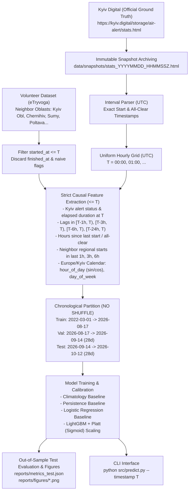

# Kyiv Air Alert Forecast 🚨

A leakage-safe machine learning system that forecasts the probability of an air raid alert in **Kyiv City** in the forward 1-hour window $[T, T+1\text{h})$ strictly using information published and available prior to moment $T$.

Evaluated out-of-sample on the freshest 28-day period (**2026-09-14 14:00 to 2026-10-12 14:00 UTC**, 672 hours) with strictly chronological splits.

---

## 📌 Problem Formulation

Given an arbitrary forecast moment $T$:
* **Target ($Y_T \in \{0, 1\}$)**: Whether any air alert in Kyiv city intersects the one-hour window $[T, T+1\text{h})$.
* **Information Constraint**: All features $\mathbf{X}_T$ must be computed strictly from events and status updates published at or before $T$ ($\mathcal{D}_{\le T}$).
* **Primary Objective**: Provide well-calibrated, reliable alert probabilities $P(Y_T = 1 \mid \mathcal{D}_{\le T})$ rather than uncalibrated scores, minimizing Brier Score and Log Loss while maximizing Brier Skill Score against historical baselines.

---

## 🏛️ Architecture & Data Sources



### Data Sources
1. **Kyiv Digital («Київ Цифровий»)** — **Primary Ground Truth**:
   - Official municipal emergency notification service for Kyiv City.
   - Parsed from public records (`https://kyiv.digital/storage/air-alert/stats.html`), providing complete alert start and all-clear timestamps from 25 February 2022 to the current day.
   - Every fetch archives an immutable raw HTML snapshot with UTC timestamp (`data/snapshots/stats_YYYYMMDD_HHMMSSZ.html`) for full provenance and auditability.
2. **Volunteer Siren Dataset (`eTryvoga`)** — **Auxiliary Spatial Proxy**:
   - Used exclusively to capture spatial alert propagation from adjacent regions: **Kyiv Oblast, Chernihiv, Sumy, Poltava, Cherkasy, and Zhytomyr**.
   - **Handling of `naive=True`**: Approximately 5% of volunteer rows have missing all-clears filled with an artificial `+30 min` duration. **All spatial neighbor features are computed strictly using `started_at`** (alert start counts and elapsed hours), ensuring zero contamination from synthetic end times.

---

## 🛡️ Strict Data Leakage Defense

Time-series forecasting in defense applications is notoriously prone to subtle lookahead bias. This project enforces multi-layered leakage prevention:

1. **Chronological Splitting (Zero Shuffle, Zero Gaps, Zero Overlaps)**:
   - **Train**: `[2022-03-01 00:00:00 UTC, 2026-08-17 14:00:00 UTC)` — 39,134 hours (1,630.6 days)
   - **Validation**: `[2026-08-17 14:00:00 UTC, 2026-09-14 14:00:00 UTC)` — 672 hours (exactly 28.0 days)
   - **Test**: `[2026-09-14 14:00:00 UTC, 2026-10-12 14:00:00 UTC)` — 672 hours (exactly 28.0 days)
   - Total continuous partition: **40,478 consecutive hours**.
2. **Ongoing Alert Masking**:
   - For any alert that began before $T$ and remains active at $T$, its eventual completion timestamp in the future is strictly masked. Features observe only the elapsed duration up to $T$.
3. **No `month` Feature**:
   - Annual calendar month features were deliberately excluded because 4 Octobers over 4 years reflect fundamentally different strategic phases of the war rather than stationary seasonality.
4. **Timezone Harmonization**:
   - Raw event timestamps are parsed and unified into UTC.
   - Diurnal calendar features (`hour_of_day`, `day_of_week`) are computed in local time (`Europe/Kyiv`), with verified support for Daylight Saving Time (DST) transitions.
5. **Automated Leakage Verification Tests (`tests/test_leakage.py`)**:
   - Tests perturb, modify, or add fake future alerts strictly after a cutoff $T_{\text{cut}}$, asserting 100% exact numerical identity for all feature vectors $\le T_{\text{cut}}$.

---

## 📊 Final Evaluation Results (Test Window: Last 28 Days)

Evaluated strictly on the held-out test split (**2026-09-14 14:00 to 2026-10-12 14:00 UTC**, 672 hours).

### Table 1: Overall Test Metrics (All 672 Hours)
| Model | Brier Score $\downarrow$ | Brier Skill Score (BSS) $\uparrow$ | ROC-AUC $\uparrow$ | PR-AUC $\uparrow$ | Log Loss $\downarrow$ |
|---|---|---|---|---|---|
| **Climatology Baseline** | 0.47920 | 0.0000 (reference) | 0.4828 | 0.5949 | 1.3658 |
| **Persistence Baseline** | 0.23390 | +0.5119 (+51.2%) | 0.7859 | 0.8337 | 0.7707 |
| **Logistic Regression** | 0.19142 | +0.6005 (+60.1%) | **0.8446** | **0.9168** | 0.5626 |
| **Calibrated LightGBM (Platt)** | **0.15689** | **+0.6726 (+67.3%)** | 0.8388 | 0.9143 | **0.4480** |

---

### Table 2: Subset A — Predicting NEW Alert Onsets (`kyiv_is_active_at_T == 0`, $N = 437$ hours)
When no alert is currently sounding in Kyiv at forecast moment $T$ (the hardest operational scenario):

| Model | Brier Score $\downarrow$ | Brier Skill Score (BSS) $\uparrow$ | ROC-AUC $\uparrow$ | PR-AUC $\uparrow$ | Log Loss $\downarrow$ | Base Rate |
|---|---|---|---|---|---|---|
| **Climatology Baseline** | 0.32099 | 0.0000 | 0.4801 | 0.3880 | 0.9443 | 40.3% |
| **Persistence Baseline** | 0.35968 | -0.1205 (-12.1%) | 0.5000 | 0.4027 | 1.1851 | 40.3% |
| **Logistic Regression** | 0.29435 | +0.0830 (+8.3%) | **0.6372** | **0.5392** | 0.8651 | 40.3% |
| **Calibrated LightGBM (Platt)** | **0.24126** | **+0.2484 (+24.8%)** | 0.6237 | 0.5092 | **0.6889** | 40.3% |

> **Key Finding**: When no alert is active, simple persistence is worse than climatology ($\text{BSS} = -0.12$), whereas **LightGBM delivers +24.8% skill** by picking up leading spatial signals from neighbor oblasts and recent activity lags.

---

### Table 3: Subset B — Alert Continuation (`kyiv_is_active_at_T == 1`, $N = 235$ hours)
When an alert is already sounding in Kyiv at moment $T$:

| Model | Brier Score $\downarrow$ | Brier Skill Score (BSS) $\uparrow$ | Log Loss $\downarrow$ | Empirical Rate |
|---|---|---|---|---|
| **Climatology Baseline** | 0.77339 | 0.0000 | 2.1498 | 100.0% |
| **Persistence Baseline** | **0.00000** | **1.0000** | **0.0000** | 100.0% |
| **Logistic Regression** | 0.00000 | 1.0000 | 0.0002 | 100.0% |
| **Calibrated LightGBM (Platt)** | **0.00000** | **1.0000** | **0.0001** | 100.0% |

---

## 📈 Diagnostic Visualizations

### 1. ROC and Precision-Recall Curves
Comparative discrimination across models on the held-out test split.


### 2. Probability Calibration (Reliability Diagram)
Smooth Platt (sigmoid) scaling ensures well-calibrated probabilities without the step-function collapses of non-parametric isotonic regression.


### 3. Feature Importance (LightGBM Gain)
Leading predictive signals include ongoing active status, recent duration lags (past 1h, 3h, 6h), and alert starts in neighbor regions.


### 4. Forecast Timeline vs Ground Truth (Last 7 Days)
Overlay of actual Kyiv alerts (red shading) against LightGBM predicted probability (green curve) and persistence baseline (orange dashed line).


---

## 🚀 Getting Started

### 1. Installation

Python 3.10+ is supported (tested on Python 3.14).

```bash
# Clone the repository
git clone https://github.com/your-username/kyiv-alert-forecast.git
cd kyiv-alert-forecast

# Create virtual environment
python3 -m venv .venv
source .venv/bin/activate

# Install locked dependencies
pip install -r requirements.txt
```

### 2. Run Tests (Zero Leakage & Timezone Integrity)

```bash
pytest -v
```

Expected output:
```text
============================== 14 passed in 1.42s ==============================
```

### 3. Re-train Models & Run Full Evaluation

```bash
python src/train_and_evaluate.py
```
This trains all models, tunes LightGBM on Validation, evaluates on Test, prints terminal metrics tables, and saves all diagnostic plots to `reports/figures/`.

### 4. CLI Inference (`src/predict.py`)

Query the forward $[T, T+1\text{h})$ alert probability for any arbitrary timestamp (or right now):

```bash
# Specific moment in Kyiv local time
python src/predict.py --timestamp "2026-10-12 18:00:00"
```

Output:
```text
======================================================================
🚨 KYIV AIR ALERT FORECAST [T, T+1h)
======================================================================
 Момент прогнозу T:
   Київський час:  2026-10-12 18:00:00 EEST
   UTC:            2026-10-12 15:00:00 UTC
 Вікно прогнозу:   [18:00, 19:00) за Києвом
 Поточний стан у Т: 🟢 ТРИВОГИ НЕМАЄ (відбій 0.2 год тому)
----------------------------------------------------------------------
 🎯 ЙМОВІРНІСТЬ ТРИВОГИ В КИЄВІ (LightGBM):  75.8%
    ├─ Калібрована (Platt / Sigmoid):         75.8%
    └─ Сира оцінка моделі (Raw LightGBM):     36.9%
    Інерційний бейзлайн (Persistence):        5.8%
    Кліматологічний бейзлайн (Climatology):   8.2%
----------------------------------------------------------------------
 🛰️  Сусідні області (Київська, Чернігів, Суми, тощо):
    Тривог почалось за останню 1 год: 0
    Тривог почалось за останні 3 год: 0
======================================================================
```

JSON output for service integration:
```bash
python src/predict.py --json
```

---

## ⚠️ Limitations & Future Work

1. **Non-Stationarity & Regime Shifts**:
   - The intensity and tactics of aerial attacks (e.g. drone attack waves vs missile strikes) fluctuate across different war phases. Models trained on earlier years need periodic rolling retraining or recency weighting.
2. **Volunteer Regional Data Lag**:
   - While Kyiv Digital updates within seconds, volunteer regional datasets can occasionally suffer scraping latency or unannounced upstream channel formatting changes.
3. **Unobserved Tactical Variables**:
   - The model observes only civilian siren logs. It does not observe strategic bomber takeoffs (Tu-95MS/Olenya), radar contacts, or sea-based cruise missile carrier sorties, which could provide additional early warning signals.
4. **Multiple Forecast Horizons**:
   - Currently focused on the immediate $[T, T+1\text{h})$ window. Future iterations could train multi-output models for horizons $T+3\text{h}$, $T+6\text{h}$, and $T+12\text{h}$.

---

## 📜 License
MIT License. Open-source research project.
